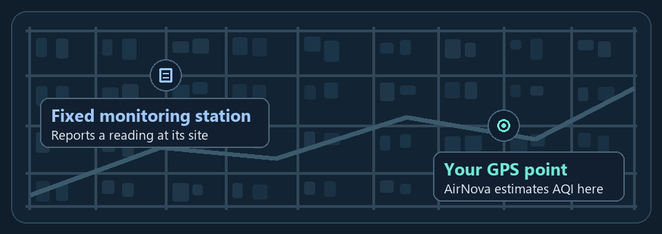

# What’s the AQI on my street?

**AirNova estimates the Air Quality Index (AQI) at a GPS point in Delhi NCR.** Monitoring stations report readings at fixed sites. Enter your latitude and longitude in the forecast dashboard to get an estimate for that location. *Street-level* refers to the point you query. The estimate’s accuracy and spatial resolution at street scale still need validation.

**[Open the live demo](https://airnova.space/)** · [72-hour forecast](https://airnova.space/prediction/) · [Run locally](#run-locally) · [Benchmark](#preliminary-benchmark)



[Open the animated illustration](docs/street-aqi.gif)


## Run locally

For a static preview, run the following from the repository root with Python 3.

```sh
python -m http.server --bind 127.0.0.1 5000
```

Open [localhost:5000](http://localhost:5000). The static preview serves the interface. For live readings and forecasts, use the [live demo](https://airnova.space/), which runs the PHP backend.

## How it works

- The browser interface includes station AQI and weather views. The [PHP routes](airnova/routes.php) supply public data to the dashboards.
- The [forecast dashboard](prediction/index.html) requests a 72-hour forecast by latitude and longitude and charts AQI, pollutant estimates, and weather indicators. The [forecast service](prediction/src/ForecastService.php) combines Copernicus CAMS air-quality data with ECMWF weather via Open-Meteo, applies CPCB station corrections when available, and uses NASA FIRMS detections for plume diagnostics.
- The [photo estimator](prediction/assets/airvision-cam.js) uses visible haze and an optional humidity adjustment to estimate PM2.5 and PM10, then converts those estimates to particulate AQI. The feature is experimental.

## Preliminary benchmark

Both comparisons cover the same 50 Delhi NCR locations.

| Comparison | Mean absolute error (AQI points) | Reference coverage |
| --- | ---: | --- |
| Calibrated CSV and workbook tab | **8.84** | 50 matched locations |
| Workbook live comparison | **82.4** | 50 matched locations, 23 distinct station labels |

Independence from calibration has yet to be established. These comparisons provide a preliminary benchmark for the matched sample.

The original benchmark files are outside this repository. The proposed field validation will hold out entire locations and time periods.

### Run the scorer on a synthetic sample

From the repository root with Python 3.11 or newer:

```sh
python benchmark/score.py benchmark/synthetic-aqi.csv
```

Expected output is **4 matched pairs** and **7.50 AQI points MAE**. The [synthetic sample](benchmark/synthetic-aqi.csv) uses invented values to demonstrate the calculation.

To score your own data, use the same CSV header. Pair each estimate with a reference observation for the same location ID and forecast valid time, expressed as an ISO 8601 UTC timestamp such as `2026-01-01T06:00:00Z`. Use the same AQI scale and averaging window for both values. Supply one row per location and valid time. If comparing different forecast lead times, score each lead time separately. The scorer checks for duplicate pairs and invalid values, then averages the absolute difference across all rows. Prepare the location and time matches before running it.

## Contributing

[Open an issue](https://github.com/Arshmansoori/airnova/issues) for a reproducible bug or a proposed change. For a forecast discrepancy, include the location, forecast issue time and target time, and the reference station and reading where available.

The planned Codex work is to automate evaluation against independent station readings matched by location and time, test how much each external feed improves forecasts, add fallbacks, and remove dependencies where the evaluation supports it. The evaluation target is mean absolute percentage error below 10% on the independent test set.

## License and credits

[MIT](LICENSE).

The original interface is preserved in [original-reference.html](original-reference.html). The landscape uses Unsplash image `photo-1470770841072-f978cf4d019e`. Typography uses Inter with a system fallback.
